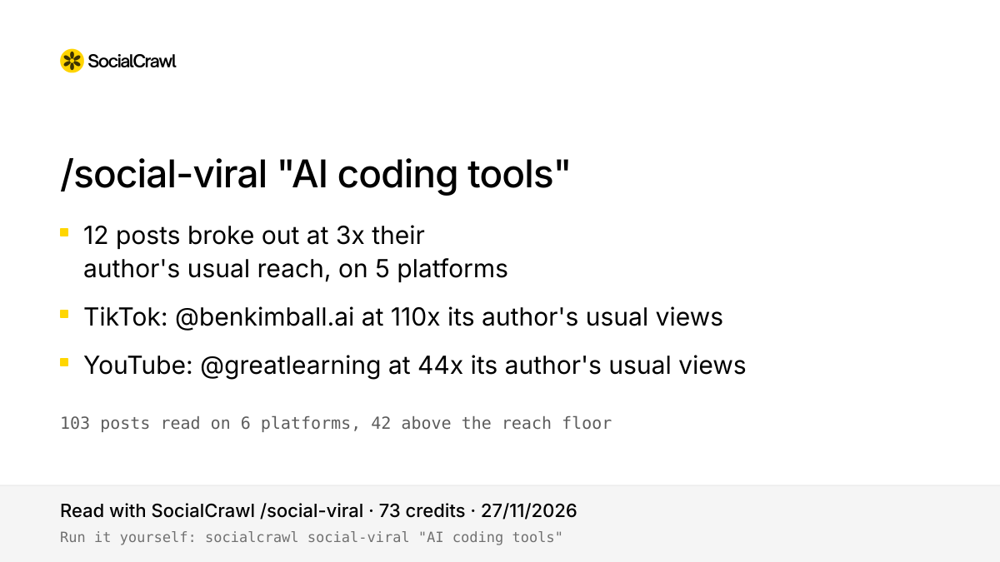

# socialcrawl

socialcrawl runs social media research from your terminal or your coding agent. You set your SocialCrawl key once, `init` installs the workflows into your agents, and each workflow reads X, TikTok, Instagram, YouTube, Reddit or LinkedIn and writes a report with its raw data.

```bash
npx -y socialcrawl@latest init
```

To add the workflow skills to your agents without the CLI, run `npx skills add socialcrawl/workflows`. Each skill is named `socialcrawl-<task>` and runs one command here: `socialcrawl-viral` runs `socialcrawl social-viral`, and the [workflows README](https://github.com/socialcrawl/workflows#skills) pairs the rest.

## What `init` does

1. Uses `SOCIALCRAWL_API_KEY` or a key you saved before. If there is none, it asks you to paste a key, or to press Enter and sign in by email with a link and a 6-digit code (a free key with 100 credits, no card).
2. Checks the key with a free balance read before it saves it to `~/.socialcrawl/config.json`, never into a project folder.
3. Finds the coding agents on your machine (Claude Code, Cursor, Codex, Gemini CLI, GitHub Copilot) and installs the workflows from [socialcrawl/workflows](https://github.com/socialcrawl/workflows) into each one with `npx skills add socialcrawl/workflows`, so `npx skills update` keeps them current. If that command fails, or a `socialcrawl-<task>` skill from somewhere else is already there, it downloads the workflows and copies them itself, leaving that skill as it was. It touches no skill outside the `socialcrawl-<task>` names, apart from removing the folders 0.1.0 installed under the old names, only where 0.1.0 put them. So the [SocialCrawl API skill](https://github.com/socialcrawl/skills) and the [MCP server](https://github.com/socialcrawl/mcp) keep working beside the workflows, on the same account.

Then ask your agent "what went viral about AI coding tools this week?", or run a workflow yourself:

```bash
socialcrawl social-viral "AI coding tools"
```

## Workflows

| Workflow | Give it | Default run, measured | At most |
| --- | --- | --- | --- |
| [`social-viral`](https://github.com/socialcrawl/workflows/tree/main/skills/socialcrawl-viral) | a topic | 61 credits | 100 |
| [`social-pulse`](https://github.com/socialcrawl/workflows/tree/main/skills/socialcrawl-pulse) | a brand or topic | 43 credits | 100 |
| [`social-presence`](https://github.com/socialcrawl/workflows/tree/main/skills/socialcrawl-presence) | a brand or public figure, and its website | 23 credits | 43 |
| [`linkedin-marketing`](https://github.com/socialcrawl/workflows/tree/main/skills/socialcrawl-linkedin-marketing) | a keyword | 48 credits | 74 |
| [`tiktok-marketing`](https://github.com/socialcrawl/workflows/tree/main/skills/socialcrawl-tiktok-marketing) | a keyword | 38 credits | 55 |
| [`instagram-marketing`](https://github.com/socialcrawl/workflows/tree/main/skills/socialcrawl-instagram-marketing) | a keyword | 39 credits | 60 |
| [`youtube-marketing`](https://github.com/socialcrawl/workflows/tree/main/skills/socialcrawl-youtube-marketing) | a keyword | 34 credits | 49 |
| [`x-marketing`](https://github.com/socialcrawl/workflows/tree/main/skills/socialcrawl-x-marketing) | a keyword | 36 credits | 55 |
| [`competitor-research`](https://github.com/socialcrawl/workflows/tree/main/skills/socialcrawl-competitor-research) | two to five brands | 48 credits | 100 |
| [`post-tracker`](https://github.com/socialcrawl/workflows/tree/main/skills/socialcrawl-post-tracker) | a post link | 2 to 5 credits, then 1 a reading | 10 |
| [`video-teardown`](https://github.com/socialcrawl/workflows/tree/main/skills/socialcrawl-video-teardown) | a TikTok, YouTube, Instagram or X video link | 7 to 29 credits, by platform | 60 |
| [`social-teardown`](https://github.com/socialcrawl/workflows/tree/main/skills/socialcrawl-teardown) | an account, or several handles of one brand | 77 credits | 100 |
| [`reddit-marketing`](https://github.com/socialcrawl/workflows/tree/main/skills/socialcrawl-reddit-marketing) | a keyword | 28 credits | 38 |

Each was measured once on 27/11/2026 with nothing cached (on "AI coding tools", "Notion" for social-pulse, "Linear" for social-presence, "Supabase, Firebase, Neon" for competitor-research, one YouTube video for post-tracker, one video per platform for video-teardown, "@notionhq" for social-teardown, "headless CMS" for reddit-marketing); each workflow's page gives its request ids. Every default run fits in the 100 credits a new account starts with. `socialcrawl --help` lists the workflows your version has.

## Example

```text
$ socialcrawl social-viral "AI coding tools"
This run reads about 67 credits (at most 100). You have …
search: 6 calls, 16 credits
baseline: 34 calls, 39 credits
amplifiers: 2 calls, 2 credits
sizes: 4 calls, 4 credits
11 posts broke out at 3x their author's usual reach, on 5 platforms
  X: an account with 2,447 followers at 48.1x its author's median views over 20 earlier posts
  Instagram: @benkimball.ai at 33.4x its author's median likes over 18 earlier posts
  Reddit: a post in r/ClaudeUniversity at 22.5x its community's median score over 17 earlier posts
  YouTube: @IBMTechnology at 18.6x its author's median views over 20 earlier posts
Not read: 4 calls (budget). Not verified: 13 items. The report lists each one.
Cost: 61 credits, 46 calls, 181.6 s.
Report: socialcrawl-runs/social-viral-ai-coding-tools-2026-11-27/report.html
```



The run folder holds:

| File | What is in it |
| --- | --- |
| `report.html` | the report on one page that works offline, with charts; every number links to the request it came from |
| `report.md` | the same report as text, for your agent or a doc |
| `card.svg` | the card above, 1200 × 675 |
| `data/*.csv` | every row the run read, so you keep the raw data |
| `responses.jsonl` | every API response, one per line, with its request id |
| `evidence.json` | each claim, its request ids, and what could not be verified |
| `run.json` | the inputs, the credits and calls of each stage, the time |

## Options

```text
socialcrawl init                     set up the key and install the workflows
  --project                          install into this project's folders, not your home folder
  --no-install                       set up the key only
  --skills-from <dir>                install from a local copy of socialcrawl/workflows
socialcrawl whoami                   the key in use and its credits
socialcrawl <workflow> "<input>"     run a workflow
  --deep                             the research-grade run: reads more, costs more
  --budget <n>                       the most credits this run may spend
  --since <date> --until <date>      the window, YYYY-MM-DD, where the workflow takes one
  --out <dir>                        the run folder (default ./socialcrawl-runs/<workflow>-<input>-<date>/)
  --plan                             print the free quote, stage by stage, and spend nothing
  --open                             open report.html when done
  --json                             print run.json instead of the summary
  --no-cache                         read everything fresh
```

Every run prints its price first, then runs. A run never spends more than its budget (the workflow's default, `--deep`'s, or `--budget`) or your balance. When your balance is short, it reads what the balance covers, says what it left out and ends with the link to top up.

| Exit code | Means |
| --- | --- |
| 0 | done |
| 1 | an error, or no key set |
| 2 | bad input: an unknown workflow or option, or a missing input |
| 3 | out of credits; the offer and what was read are printed |

## What it stores and sends

- `~/.socialcrawl/config.json`, readable by you only where the system allows it: your API key, or the tokens of an email sign-in (refreshed when they expire), and the list of agents `init` installed into. Delete the folder to remove them.
- Run folders where you run the command: the posts, comments and numbers the run read, including other people's public posts. They stay on your machine.
- Each workflow's `SKILL.md` and `README.md`, in your agents' skills folders.
- Requests go to `https://www.socialcrawl.dev/v1` with your key, and name the client as `socialcrawl-cli/<version>`. This CLI sends no analytics of its own.
- `init` runs `npx skills add socialcrawl/workflows`, which fetches the workflows from GitHub and, like any install with that command, tells skills.sh which skills were installed for which agents, without your key or any account detail. Set `DO_NOT_TRACK=1` or `DISABLE_TELEMETRY=1` to stop that count.

## Develop

Node 20 or later.

```bash
npm install
npm test          # tsc --strict, then node --test
npm run build     # dist/cli.js
```

Workflows live in `src/workflows/<name>/` and implement `Workflow` from `src/workflows/types.ts`. Every API call goes through the `Session` in `src/kit/record.ts`, which applies the run's budget, sends `max_pages` on every list call and keeps each response.

## Release

1. Set the version in `package.json` and `src/version.ts`, and date its entry in `CHANGELOG.md`: `## 0.1.0 (DD/MM/YYYY)`.
2. Run `npm run release:check` with `SOCIALCRAWL_LEAK_GATE` set to the leak gate. It runs the gate, the whole suite and the build, and checks the version, the changelog entry and the files the package would publish.
3. `git tag v0.1.0 && git push origin v0.1.0`. The release workflow publishes to npm through trusted publishing, with provenance, and creates the GitHub release from the changelog entry. [RELEASING.md](RELEASING.md) has the full steps, including the first release by hand.

## Licence

MIT. Methods adapted from other MIT projects are credited in [THIRD_PARTY_NOTICES.md](THIRD_PARTY_NOTICES.md). The SocialCrawl name and logo (`assets/`, `docs/`) are not covered by the MIT licence.

Help: socialcrawl@ridio.io
